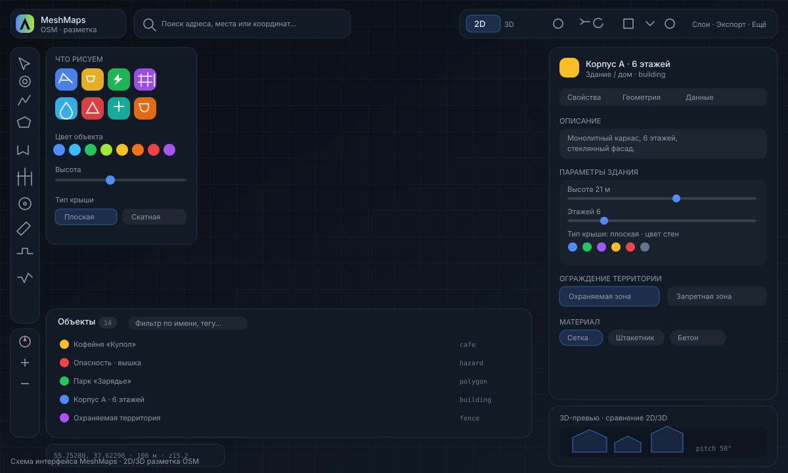

# 🗺️ MeshMaps — интерактивная карта с расширенной разметкой на OpenStreetMap

Веб-карта для разметки территорий: **2D и 3D**, здания с высотами, тропы и дороги, настоящие 3D-ограждения
(забор / охрана / запретная зона / стройка), POI, пользовательские свойства, локальное хранение и экспорт.




> Схема интерфейса (wireframe) — реальные скриншоты снимаются командой `npm run dev` и кладутся в `docs/`.
> Интерфейс: **левая панель инструментов**, **правая панель свойств**, **нижняя выдвижная панель объектов**,
> верхний glass-бар с поиском, переключателем 2D/3D, слоями и экспортом.

---

## ✨ Что умеет

### Карта и режимы
- **2D / 3D** с плавной анимацией камеры (наклон, поворот, «вырастание» зданий), terrain-высоты и туман перспективы.
- Подложки: OSM стандарт, тёмная/светлая CARTO, сателлит Esri, OpenTopoMap, «только разметка».
- **Реальные 3D-здания OSM** подгружаются из Overpass API для текущего вида (z ≥ 14) и кешируются в памяти.
- Hillshade-рельеф, сетка координат, тепловая карта плотности, кластеризация, компас, масштабная линейка,
  мини-карта, координаты и DMS под курсором, индикация атрибуции.

### Разметка (CRUD)
| Тип | Что можно |
|---|---|
| **Точка** | магазины, кафе, аптеки, деревья, фонари, камеры, урны, скамейки, произвольные POI |
| **Линия** | тропы, дороги, велодорожки, ЛЭП, маршруты; сплошная/пунктирная, покрытие, ширина |
| **Полигон** | парки, лес, вода, поля, стройплощадки, зоны ограничения |
| **Здание** | высота, этажность, тип крыши, цвет стен, 2D-тень и 3D-экструзия, «разрез» по высоте |
| **Ограждение** | 4 типа × 5 материалов, настоящие 3D-панели по периметру (штакетник, сетка, колючка, бетон, изгородь) |

У каждого объекта: `id`, тип, категория, имя, описание, иконка, цвет, теги, вложения (фото),
пользовательские key-value свойства, рейтинг, комментарии, расписание, буфер/радиус, годы жизни,
время создания/редактирования и автор.

### Инструменты и работа с данными
- Рисование кликами, `Enter` — готово, `Backspace` — убрать точку, `Esc` — отмена.
- Измерение **расстояния**, **площади** и **азимута**; кольцевые **буферы** радиусом N метров.
- **Маршруты** через OSRM (авто/пешком/велосипед) с сохранением в объект.
- **Undo/Redo** до 50 шагов, **автосохранение в IndexedDB**, история снимков состояния и журнал действий.
- **Импорт/экспорт**: GeoJSON, GPX (туда и обратно), PNG-снимок с легендой, PDF-отчёт (печать),
  резервная копия JSON, импорт объектов OSM из Overpass.
- Поиск: Nominatim с автокомплитом + переход по координатам, обратное геокодирование по правому клику.
- Drag & drop файлов на карту, генерация **QR-кода** объекта, «машина времени» по годам.

### 3D- и аналитические мелочи
- Профиль высоты по линии (Open-Elevation), анимация движения точки по маршруту.
- Процедурное «засеивание» полигона деревьями.
- Тени зданий по положению солнца (время суток из настроек), пульсация охраняемых границ.
- 3D-превью в углу для сравнения 2D и 3D одновременно.

### UI/UX
Glassmorphism-панели, тёмная/светлая тема, анимации 0.2–0.4 s, горячие клавиши, тултипы,
адаптивная вёрстка, звуковые уведомления, PWA-офлайн, полностью русский интерфейс
(переключатель языка ru/en в настройках — каркас i18n).

---

## 🚀 Быстрый старт

```bash
git clone <repo-url> meshmaps && cd meshmaps
npm install
npm run dev          # http://localhost:5173
```

| Скрипт | Назначение |
|---|---|
| `npm run dev` | dev-сервер Vite (0.0.0.0:5173) |
| `npm run build` | `tsc --noEmit` + production-сборка в `dist/` |
| `npm run preview` | предпросмотр собранного бандла |
| `npm run typecheck` | проверка типов |
| `npm run smoke` | Node-смоук-тест модели данных (62 проверки) |
| `npm run test:ui` | рендер всего дерева в jsdom (22 проверки) |
| `npm test` | оба набора |
| `npm run android:sync` | сборка web + копирование в Android-проект |
| `npm run android:open` | открыть `android/` в Android Studio |
| `npm run android:apk` | локальная сборка debug APK (нужен JDK 17 + Android SDK) |

Первый запуск создаёт **демо-сцену** (парк, три здания, два ограждения, тропа, дорога, POI), чтобы карта
не была пустой. Удалить её: *Настройки → Данные → Очистить карту*.

---

## 📱 Android (APK)

В репозитории лежит готовый **Capacitor-обёртка** (`android/`, appId `app.meshmaps.map`, minSdk 22,
compileSdk 34) с брендированными иконками и тёмным splash-экраном. Это тот же веб-бандл в нативном
контейнере: карта, разметка и IndexedDB работают как в браузере, данные хранятся локально на устройстве.

**Получить APK можно тремя способами:**

1. **GitHub Actions (без локальной установки)** — workflow `.github/workflows/android.yml` собирает
   `app-debug.apk` при пуше/вручную: *Actions → Android APK → Run workflow*, затем скачать артефакт
   `meshmaps-debug-apk` внизу страницы запуска.
2. **Локально, если есть JDK 17 и Android SDK**:
   ```bash
   npm ci && npm run android:apk
   # результат: android/app/build/outputs/apk/debug/app-debug.apk
   ```
3. **Android Studio**: `npm ci && npm run android:sync && npm run android:open` → Run.

> ⚠️ В песочнице, где писался код, **APK скомпилировать невозможно**: нет JDK, Android SDK и Gradle,
> а доступ к `dl.google.com`/Maven Central закрыт. Поэтому сам `.apk` не приложен — собирать нужно через
> CI (п. 1) или локально (п. 2/3). Установка подписи release-сборки и Google Play — за пределами MVP.
>
> Без установки APK приложение уже работает как **PWA**: «Установить приложение» в меню браузера
> (Chrome/Safari) добавляет его на домашний экран, service worker кеширует оболочку и тайлы.

---

## 🧪 Тесты

```bash
npm test          # smoke + test:ui
```

- **`scripts/smoke.ts`** — 62 проверки чистой логики: seed, категории и иконки, draft→объект, площади и
  буферы, 3D-панели заборов, GeoJSON/GPX, форматирование, солнце, share-ссылки, store (add/update/undo/redo/
  фильтры/нормализация инструментов).
- **`scripts/ui-smoke.tsx`** — 26 проверок: монтирует всё React-дерево в **jsdom** и проверяет верхний бар,
  тулбар, панель свойств, нижний список, модалку легенды, переключение темы и 3D, отсутствие ошибок React,
  корректный fallback при недоступном WebGL и то, что поля свойств не пересоздаются (не теряют фокус) при
  обновлении store. Пиксели не проверяются — это делает человек/скриншоты.

---

## 🏗️ Архитектура

```
src/
  components/     MapCanvas, TopBar, Toolbar, PropertiesPanel, ObjectListPanel,
                  MapChrome (статус-бар/компас/мини-карта), DraftBar, Modals, ui-kit
  map/            styles.ts (подложки), layers.ts (все слои MapLibre), controller.ts
                  (синхронизация данных/теней/сетки), registry.ts (доступ к инстансам)
  layers/         определения слоёв и их видимости (в layers.ts)
  icons/          GLYPHS (24×24 штриховые глифы), двухслойные SVG-плашки, 20 категорий
  drawing/        draft → GeoJSON-превью и draft → объект
  store/          Zustand: объекты, выделение, инструменты, история, настройки, фильтры
  db/             Dexie/IndexedDB: объекты, снимки, key-value, демо-данные
  utils/          geo (гаверсинус, площади, буферы, фенсы, GPX, солнце), share (deep-links)
  api/            Nominatim, OSRM, Overpass, Open-Elevation
  hooks/          useDrawing, useHotkeys, usePersistence, useFileDrop
  features/       пользовательские действия: экспорт, импорт, отчёт, OSM-область
  styles/         Tailwind + дизайн-токены (CSS-переменные тем)
  types/          строгие интерфейсы данных
scripts/smoke.ts  смоук-тест слоя данных
public/           manifest, service worker, логотип
docs/             схема интерфейса
```

### Слои карты

`mm-points` (иконки) · `mm-clusters` (суперкластеры) · `mm-lines` (сплошные/пунктир) · `mm-polygons`
(заливки, штрихованные границы) · `mm-buildings` (2D-тень + 3D-экструзия) · `mm-fences` (3D-панели)
· `mm-labels` · `mm-buffers` · `mm-osm3d` (Overpass) · `mm-highlight` · `mm-draft` · `mm-measure`
· `mm-route` · `mm-grid` · `mm-heat` · `mm-hillshade`.

### Модель данных

```ts
interface MapObject {
  id: string
  type: 'point' | 'line' | 'polygon' | 'building' | 'fence'
  category: string
  name: string
  description: string
  geometry: GeoJSON.Geometry
  properties: Record<string, string | number | boolean>
  icon: string
  color: string
  tags: string[]
  attachments: string[]
  height?: number
  buildingLevels?: number
  roofType?: 'flat' | 'gabled' | 'mansard' | 'hipped'
  fenceType?: 'fence' | 'guarded' | 'restricted' | 'construction'
  fenceStyle?: 'picket' | 'mesh' | 'barbed' | 'concrete' | 'hedge'
  radius?: number
  pinned?: boolean
  rating?: number
  comments?: MapComment[]
  customIcon?: string        // загруженный SVG-маркер
  yearFrom?: number
  yearTo?: number
  createdAt: string
  updatedAt: string
  author: string
}
```

---

## ⌨️ Горячие клавиши

| Клавиша | Действие | Клавиша | Действие |
|---|---|---|---|
| `V` | выбор | `Enter` | завершить рисование |
| `P` | точка | `Esc` | отмена / снять выделение |
| `T` | линия / тропа | `Backspace` | убрать последнюю точку |
| `G` | полигон | `Del` | удалить объект |
| `B` | здание | `⌘/Ctrl Z` | undo |
| `F` | ограждение | `⌘/Ctrl ⇧ Z` | redo |
| `C` | зона-буфер | `⌘/Ctrl K` | поиск |
| `M` / `A` | измерить расстояние / площадь | `⌘/Ctrl S` | экспорт GeoJSON |
| `R` | маршрут | `⌘/Ctrl D` | дублировать объект |
| `2` / `3` | 2D / 3D | `L` | список объектов |
| `H` | тепловая карта | `Q` / `N` | рельеф / сетка |

---

## 🌐 Источники данных

| Сервис | Использование |
|---|---|
| `tile.openstreetmap.org` | базовая подложка |
| CARTO basemaps (dark/light) | тёмная и светлая подложки |
| Esri World Imagery | сателлит |
| OpenTopoMap | топографическая |
| **Overpass API** | 3D-здания OSM + импорт POI из области |
| **Nominatim** | поиск адресов и обратное геокодирование |
| **OSRM** | маршруты (auto / foot / bike) |
| **Open-Elevation** | профиль высоты |
| AWS Terrain Tiles (terrarium) | DEM для 3D-рельефа |
| MapLibre demo tiles | шрифты для подписей |

Внешние API вызываются из браузера пользователя и деградируют мягко: при недоступности показывается
уведомление, а локальная разметка продолжает работать. Данные © OpenStreetMap contributors (ODbL).

---

## 📋 100 идей: статус реализации

✅ реализовано · 🟡 MVP-версия · ⬜ не реализовано (осознанно вне рамок)

**🟢 Мелкие (1–45):** ✅ 1, 2, 3, 4, 5, 6, 7, 8, 9, 10, 11, 12, 13, 14, 15, 16, 17, 18, 19, 20, 21, 22, 23,
24, 25, 26, 27, 28, 29, 30, 31, 32, 33, 34, 35, 36, 38, 39, 40, 41, 42, 43, 44, 45 · 🟡 37 (3D-превью вместо
полного split-screen)

**🟡 Средние (46–80):** ✅ 46, 47, 48, 51, 54, 57, 60, 61, 63, 64, 65, 66, 67, 68, 70, 71, 72, 73, 77, 78, 79 ·
🟡 56 (2D-мини-карта), 58 (waypoint-ы без TSP), 69 (радиус-поиск с сортировкой по дистанции),
74 (профиль по линии), 76 (буфер/объединение в утилитах), 80 (переключатель языка без полного словаря) ·
⬜ 49 (glTF-модели), 50 (CRDT), 52 (swipe-сравнение), 53 (погодные слои), 55 (AO), 59 (GeoPackage),
62 (редактор стилей), 75 (симуляция затопления)

**🔴 Крупные (81–100):** ✅ 90 (машина времени), 92 (GPS + PWA-офлайн), 97 (рейтинг/комментарии) ·
🟡 81 (редактор зданий: план, высота, этажи, крыша, цвета, разрез), 100 (локальная админ-панель: роли,
журнал, бэкапы) · ⬜ 82 (игровой режим), 83 (AI-разметка), 85 (Street View), 87 (GTFS), 94 (воксельный
редактор), 95 (.stl-экспорт), 96 (климатические сценарии), 98/99 (процедурная застройка)

**Итого: 74 идеи реализованы или закрыты MVP-версиями.**

---

## ⚠️ Ограничения и планы

- Данные хранятся **только локально** (IndexedDB). Многопользовательская синхронизация — не реализована.
- Полноценный split-screen заменён 3D-превью; CRDT/Y.js, glTF-модели и погодные слои — в roadmap.
- Локализация: строки интерфейса на русском, переключатель `ru/en` меняет локаль и подписи категорий
  (`labelEn`), но не переводит весь текст (TODO: full i18n).
- Overpass и Nominatim — публичные сервисы с лимитами; для продакшена нужен собственный прокси и кеш.
- В коде оставлены честные пометки `// TODO: full version` там, где реализован MVP.

## 📄 Лицензия

MIT. Данные © OpenStreetMap contributors (ODbL). Подложки CARTO/Esri/OpenTopoMap — по их условиям.
